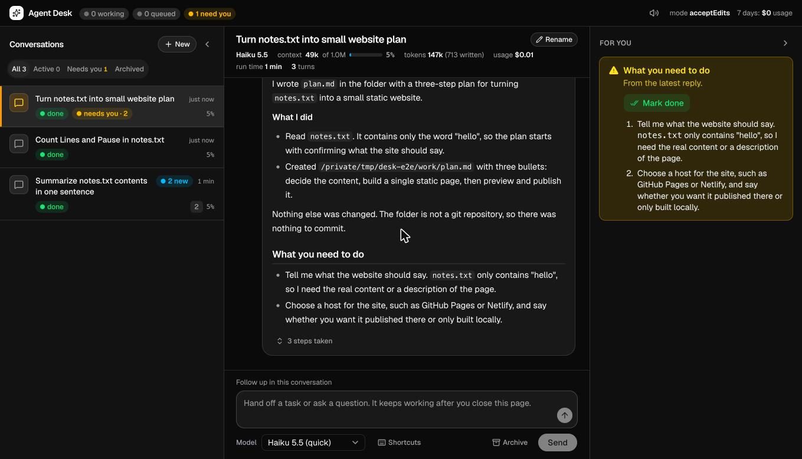

# Agent Desk

A fast web desk for Claude Code.
Hand off a task, close the tab, and come back to the result.



I stopped running my day from a terminal.
Every request I would have typed into `claude` now goes into this page instead, and each one runs as its own headless Claude Code session on an always-on computer.
I can run several at once, read along while they work, follow up later in the same conversation with full memory, and see in one rail exactly what is waiting on me.

## What it does

- **One message, one Claude Code run.** Each message runs `claude -p` in your chosen folder with your own Claude Code setup (skills, MCP servers, CLAUDE.md, permission rules).
- **Conversations remember.** A conversation is one Claude session: the first message starts it and follow-ups resume it.
- **Several at once.** Up to `DESK_MAX_PARALLEL` conversations run side by side; each conversation answers one message at a time, and later messages queue behind it.
- **Watch it work.** The current step, the steps so far and the reply streaming in as it is written, plus a Stop button.
- **"What you need to do".** Runs are told to end with that section when only you can do something; the page lifts those items into a rail and a "needs you" filter, with Mark done.
- **Close the tab whenever.** Runs live on the server, not in the browser; a pop plays and the tab title counts unread replies when they finish.
- **Context and cost at a glance.** Model, context used, tokens, run time, turns and the API-equivalent cost of each reply and conversation.
- **Fast to drive.** Enter sends, `N` starts a conversation, Shift+Up/Down switches conversations, Shift+Left/Right steps through messages, drafts are kept per conversation.
- **Titles, links, archive.** Conversations get a short title from a quick Haiku call, every link a reply mentions sits behind one Links button, and finished conversations can be archived.
- **Works on a phone.** The layout collapses to one pane at a time.

## Quick start

You need Node 20 or newer and [Claude Code](https://code.claude.com) installed and signed in (`claude` on your PATH).

```sh
git clone https://github.com/lukegeel101/agent-desk.git
cd agent-desk
npm run setup     # installs and builds the page
npm start         # http://127.0.0.1:4280
```

Open <http://127.0.0.1:4280> and send a message.

## Settings

Copy `desk.env.example` to `desk.env` and uncomment what you need; environment variables win over the file.
The ones that matter most:

| Setting | Default | What it does |
|---|---|---|
| `DESK_WORKDIR` | your home folder | The folder every run starts in |
| `DESK_PERMISSION_MODE` | `acceptEdits` | How runs may act without asking: `acceptEdits`, `auto` or `bypassPermissions` |
| `DESK_MODEL` | `sonnet` | Default model for new messages (`opus`, `sonnet`, `haiku`); the page's picker overrides it |
| `DESK_MAX_PARALLEL` | `3` | Runs at once |
| `DESK_TIMEOUT_MIN` | `60` | A run is stopped after this many minutes |
| `DESK_EXTRA_ARGS` | none | Extra `claude` flags for every run, such as `--chrome` or `--add-dir ~/notes` |
| `DESK_SYSTEM_PROMPT_FILE` | built in | Replace the instructions appended to Claude Code's system prompt |

### Permissions

Nobody is at a terminal to approve prompts, so the permission mode decides what a run may do on its own.
`acceptEdits` (the default) lets it edit files; any other tool needs an allow rule in your Claude Code settings, and refused actions are listed under the reply.
`auto` lets a classifier approve safe actions and block risky ones, which is how I run it day to day.
`bypassPermissions` allows everything; use it only on a machine and account you are comfortable handing over completely.

The built-in instructions also tell every run that your message approves only the actions it names, and to ask before anything destructive, irreversible, or sent on your behalf.

## Run it all the time

The point is a computer that keeps working while you are away from it.
On a Mac, `deploy/com.example.agent-desk.plist` is a LaunchAgent that starts the desk at login and restarts it if it stops; on Linux, use `deploy/agent-desk.service`.
Each file says how to install it.

### From your phone

By default the desk only answers the computer it runs on.
To reach it from your phone, put both on a private network such as [Tailscale](https://tailscale.com), then set:

```sh
DESK_HOST=100.x.y.z                 # the computer's Tailscale address
DESK_TOKEN=$(openssl rand -hex 32)  # required whenever DESK_HOST is not 127.0.0.1
```

Open `http://100.x.y.z:4280/?token=<your token>` once on the phone; the token moves into a cookie and out of the address bar.
Do not expose the desk to the public internet: whoever can send it a message can act as you on that computer.

## How it works

```
browser ──poll /api/state──▶ server/index.mjs ──▶ server/desk.mjs ──spawn──▶ claude -p --output-format stream-json
                                   │                     │                           │
                                   └── web/dist (React)  └── data/state.json          └── data/runs/<id>.jsonl
```

- `server/` is plain Node with no dependencies: an HTTP server, a queue, and a parser for Claude Code's stream-json events.
- `web/` is a React and Tailwind page built with Vite; the server serves its `dist/` build.
- State is one JSON file in `data/`, written atomically; each run's raw event stream sits next to it in `data/runs/`.
- Writes require an `X-Desk` header, which forces a CORS preflight the server never approves, so other websites open in your browser cannot send it messages.
- Stopping the server stops its runs; on the next start, anything that was running is marked interrupted.

## Develop

```sh
npm start              # the server, on 4280
npm run dev            # the page with hot reload on 5199, talking to the server on 4280
npm run check          # server tests, lint, type check and build
```

`npm test` runs the server against `test/fake-claude.mjs`, a stand-in that prints stream-json like a real run, so the tests need no Claude account.
Known pitfalls are in [docs/gotchas.md](docs/gotchas.md).

## License

MIT
